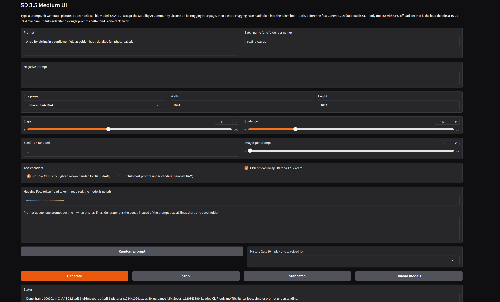

# SD 3.5 Medium UI

## Before you start

- **This model is GATED — two steps, both required, before the first Generate can succeed:**
  1. Go to the model page (huggingface.co/stabilityai/stable-diffusion-3.5-medium), sign in, and **accept the Stability AI Community License** there.
  2. Create a Hugging Face **read token** (Hugging Face → Settings → Access Tokens), and **paste it into the token box in the app**. Same account for both steps.
  Without both, Hugging Face refuses the download and Generate reports that plainly. No way around it — that is Stability's gate, not a bug in this app.
- A Windows PC. No Python install needed — Python 3.12 is included in this package, in the `python_embeded` folder, ComfyUI portable style. Any Python you already have is left alone and is not needed.
- An NVIDIA graphics card (12 GB is plenty), about 20 GB free disk space, and an internet connection.
- The first Generate downloads the model weights: about 6.5 GB on the default CLIP-only load (the T5 files are skipped), about 16 GB if you switch to T5 full.

**SD 3.5 Medium, without Jupyter and without Colab.**

Stable Diffusion 3.5 Medium is Stability AI's 2.5B MMDiT image model: strong prompt following (three text encoders — CLIP-L, CLIP-G, and T5-XXL), good text rendering for its size, and a look of its own next to Kandinsky, Sana, and Z-Image. This is a plain app: run it, a page opens in your browser, type a prompt, pictures appear. Built in the same shape as Kandinsky UI, Sana UI, and Z-Image UI, free forever.

*The app*

*Example render — porcelain cyborg (CLIP-only load)*

*Example render — porcelain cyborg, full prompt (T5 full load)*

*Example render — porcelain cyborg, dark metal (T5 full load)*

*Example render — porcelain cyborg with medallion (T5 full load)*

*Example render — opal lucifer princess (T5 full load)*

## What it does

- Text-to-image generation on your own GPU -- no cloud, no Stability account (a free Hugging Face account is needed for the gate, above)
- Prompt + negative prompt, steps slider (default 40), guidance slider (default 4.5) — the model card's own snippet values
- Text-encoder choice: **No T5 — CLIP only (the default, lighter)** or **T5 full (best prompt understanding, heaviest RAM)** — see Requirements for why the default is what it is
- CPU offload toggle (default ON) — together with the CLIP-only default, that is what makes this fit a 12 GB card with 16 GB of RAM
- Hugging Face token box (password field — the token is used for the download and never written to settings.txt or anywhere else)
- Size presets (Square 1024, Small square 768, Portrait 768x1024, Landscape 1024x768) plus custom width/height boxes, up to 2048
- Up to 10 pictures per prompt, each with its own seed, saved as 000001.png, 000002.png, and so on
- Seed shown in the status line (-1 = random; a fixed seed S gives S, S+1, S+2, ... across a multi-image run)
- A Random prompt button (word banks built in, no list file), and a session-only prompt history dropdown
- A Stop button to cancel a run, and Star batch to copy a batch into images_out/favorites/
- A prompt queue (one prompt per line -- when it has lines, Generate runs the queue instead of the single prompt box, all lines sharing the one batch folder, frames numbered continuously)
- Dynamic prompts: {a|b|c} groups, one random pick per group, re-expanded for every single image (prompt and negative prompt). settings.txt records the expanded prompt actually used
- An Unload models button to free VRAM and RAM, and memory freed between every image in a run (long queues keep working)
- Every run adds its pictures to the batch folder and appends a block to `settings.txt` next to them (date, time, frame range, settings including T5 mode and offload, prompt, negative prompt, expanded prompts, seeds)

No animation, no upscaling, no editing, no ControlNet, no inpainting, no img2img -- v1 is text-to-image only, kept simple on purpose.

## Requirements

- Windows, an NVIDIA GPU (12 GB is plenty), and a recent driver
- Python 3.12 is bundled in the `python_embeded` folder: Diffusers 0.42 dropped Python 3.10, so this app runs on its own included 3.12 and nothing else. No Python install, no PATH changes, no venv — your other Pythons are left completely alone, and this app lives entirely in this folder
- Disk space: about 20 GB free for the first download, plus room for pictures
- System RAM: this is the honest part. Stability says SD 3.5 Medium needs 9.9 GB of VRAM *excluding* the text encoders, and with CPU offload the weights live in **system RAM** while one component at a time uses the GPU. T5-XXL alone is about 9.4 GB of weights, so the full three-encoder set is about 16 GB — on a machine with 16 GB of RAM total, T5 full will page hard or run out of memory; it is not the default for that reason. The default CLIP-only load is about 6.5 GB of weights and fits comfortably in 16 GB of RAM.
- What you give up with CLIP only: the two CLIP encoders carry the prompt in 77-token windows and the pipeline feeds zeros where the T5 embeddings would go (a documented Diffusers SD3 pattern). Short and medium prompts work well; long, complex, multi-clause prompts follow noticeably less closely than with T5. If you have 32 GB of RAM, T5 full is the better load — switch the radio and the next Generate reloads.

## Install

1. Do the two gate steps in "Before you start" (license acceptance + read token). Install works without them, but the first Generate will not.
2. Extract the whole zip somewhere plain, like `C:\AI\sd35-ui` — the folder holding `install.bat` is the app folder.
3. Double-click `install.bat` and wait -- it sets up pip inside the bundled Python, then installs PyTorch with CUDA plus the packages into it. Run it again if anything interrupts it; it resumes where it stopped.
4. Double-click `run.bat`. A page opens in your browser. Paste your token, type a prompt, hit Generate.

install.bat does NOT need re-running for code-only updates: if only app.py changed, just replace the file and run run.bat again.

## First test

1. Leave everything at the defaults — CLIP-only (no T5), offload on, 1024x1024, 40 steps, guidance 4.5 — paste your token, and hit Generate.
2. The first run downloads the model (about 6.5 GB on this load), so it takes a while -- that is the one-time download, not a stuck render.
3. If the status says the load could not happen and mentions the gate, the token or the license acceptance is the problem, in that order: check the token is a READ token from the same Hugging Face account that accepted the license.
4. When the default test works, try T5 full *if your machine has the RAM for it* (see Requirements) — expect a much bigger download (~16 GB total) and a slower load, in exchange for better long-prompt following.
5. If a run fails with an out-of-memory error on a 16 GB RAM machine, you are almost certainly on T5 full or offload off — go back to CLIP-only with offload ON; that combination is the proven-shape default for this class of machine (real-machine proof for this specific build is the author's first install — see Code verification).

## Where pictures go

`images_out/` next to `run.bat`, one subfolder per batch name, reused across runs -- repeat runs with the same batch name add pictures to the same folder, numbered continuously (`000001.png`, `000002.png`, ...), so nothing is ever overwritten. `settings.txt` in the folder grows by one block per run (date, time, frame range, prompt, negative prompt, expanded prompts, size, steps, guidance, max sequence length, T5 mode, offload, seeds). The token is never recorded. Starred batches land in `images_out/favorites/`.

## How it works

Diffusers 0.42.0, StableDiffusion3Pipeline:

1. `StableDiffusion3Pipeline.from_pretrained("stabilityai/stable-diffusion-3.5-medium", torch_dtype=torch.bfloat16, token=<token box>)`. With "No T5" selected, `text_encoder_3=None` and `tokenizer_3=None` are also passed — verified in the diffusers 0.42.0 wheel: its `encode_prompt` checks `text_encoder_3 is None` and returns zero embeddings of the right shape, and the CLIP encoders carry the prompt. With "T5 full", nothing is overridden and all three encoders load in bfloat16. (Loading T5 separately in float16 — a pattern in some guides — was checked and deliberately not used: float16 is the same 2 bytes per parameter as bfloat16, so it saves no RAM and only adds code.)
2. With offload ON (the default), `enable_model_cpu_offload()` keeps the components in RAM and moves one at a time to the GPU. With offload OFF, everything goes to GPU with `.to("cuda")` -- only for cards with much more than 12 GB of VRAM.
3. The pipeline call is `pipe(prompt, negative_prompt, height, width, num_inference_steps=<steps slider>, guidance_scale=<guidance slider>, max_sequence_length=256, generator)` with one CPU generator per image (seeded from the seed box), following the model card's own snippet (which uses 40 steps and guidance 4.5). The CPU generator is deliberate: it works identically with offload on or off.
4. `max_sequence_length=256` is the pipeline's own default, and the plain model-card snippet's implicit value. A community quant example uses 512; that was not copied, because the pipeline builds a (batch, sequence, joint-attention-dim) embedding at that length — even with T5 off — so 512 costs memory on every image for a benefit only very long T5 prompts would see.

Notes and known limits of this build:

- The gate is real: no token, or a token from an account that has not accepted the license, means no download. The app surfaces that as a plain status message with the two things to check.
- On 16 GB of RAM, treat T5 full as experimental: it may work slowly through the pagefile rather than failing outright. That uncertainty is honest — the author's machine class is exactly 16 GB, and the real answer comes from the first install test, not from this build machine.
- Nothing about the model is bundled here; weights download from Stability's repo under their license (below).

## Code verification (no GPU in the build environment)

- `app.py` compiles clean (`py_compile`).
- The pipeline class and the No-T5 pattern were verified against the diffusers 0.42.0 wheel itself (not just docs): `StableDiffusion3Pipeline` exists, `text_encoder_3=None` is an explicitly handled path, and `max_sequence_length` defaults to 256 with a hard cap of 512.
- The requirements set (minus accelerate — see the note at the top of requirements.txt for why) was verified end-to-end with pip's resolver for Windows / Python 3.12, resolving to exactly the pinned versions; accelerate 1.15.0 was verified separately from its wheel metadata.
- The loader and generation paths are stub-tested with fake pipeline modules: CLIP-only vs T5-full arguments to from_pretrained, token passing (and its absence when the box is empty), offload on/off, load-failure message, steps/guidance/max-sequence pass-through, seed resolution, dynamic expansion, batch-folder/settings logic (continuous 6-digit frames, appended settings blocks, T5 mode recorded), queue-over-prompt, history, star, and the early-exit paths. The stub test is not shipped in the zip.
- What is NOT verified here: the real install on Windows, the real gated download, and the first picture on a 12 GB / 16 GB machine. Those are proven by the author's install, not by this build machine — same boundary as the other apps.

## Models and permissions

The model belongs to Stability AI — see its Hugging Face page for terms. SD 3.5 Medium is under the **Stability AI Community License**: free for research, non-commercial, and commercial use for organizations under $1M in annual revenue; an enterprise license is required above that. Outputs are yours subject to that license's terms. **The model is NOT MIT or Apache, and this app does not change that.** Nothing is bundled here and nothing is sold. This UI (the Gradio app, the wrapper, the installer) is by Alan Carmack.

## License

MIT for this UI code -- free to use, share, and change. The model has its own license, above.
